# Regras do projeto, num mapa

<!-- standards:begin map v0.3.1 -->

O mapa visual de tudo o que é regra para desenvolver, versionar e publicar neste projeto: o
que fazer, em que ordem, quando parar e o que a automação garante.

> **Este arquivo é um mapa, não a fonte.** Cada regra está escrita no documento indicado ao
> lado dela, e é lá que ela muda primeiro. Se este mapa divergir da fonte, a fonte vale, e o
> mapa é corrigido no mesmo PR. Ele vem do [dev-standards](https://github.com/diego-castilho/dev-standards)
> e é atualizado junto com o padrão.

**Garantia de cada regra:**

| Marca | Significa |
|---|---|
| **Doc** | Escrita num documento; depende de quem lê |
| **Skill** | Roteiro executável (`/release`, `/hotfix`, `/xrepo`) |
| **Auto** | O CI ou o GitHub fazem sozinhos |
| **Confirma** | Um hook pede a confirmação do mantenedor antes de seguir |
| **Bloqueado** | Um hook ou o GitHub (ruleset) recusa sempre |

> **Rulesets e repositório privado.** As travas marcadas "GitHub" valem em repositório
> público em qualquer plano e, em repositório privado, exigem GitHub Pro. Com o Pro ativo,
> `rulesets.sh` as aplica a todos os repositórios do padrão; os hooks continuam como segunda
> barreira para o agente.

## Sumário

1. [Onde vive cada regra](#1-onde-vive-cada-regra)
2. [O ciclo de uma mudança](#2-o-ciclo-de-uma-mudança)
3. [Gitflow](#3-gitflow)
4. [Branches](#4-branches)
5. [Commits](#5-commits)
6. [Pull requests e merge](#6-pull-requests-e-merge)
7. [Release](#7-release)
8. [Hotfix](#8-hotfix)
9. [Issues, tipos e Projects](#9-issues-tipos-e-projects)
10. [Pedidos entre repositórios](#10-pedidos-entre-repositórios)
11. [Trabalho com agentes](#11-trabalho-com-agentes)
12. [Travas automáticas](#12-travas-automáticas)
13. [Dependências e Actions](#13-dependências-e-actions)
14. [Dados sensíveis e idiomas](#14-dados-sensíveis-e-idiomas)

---

## 1. Onde vive cada regra

Cada regra tem **uma fonte só**. Os outros lugares apontam para ela. A regra fica no recurso
nativo do GitHub sempre que ele existe; script só onde o GitHub não chega
([ADR-0001](adr/0001-recursos-nativos-do-github-primeiro.md)).

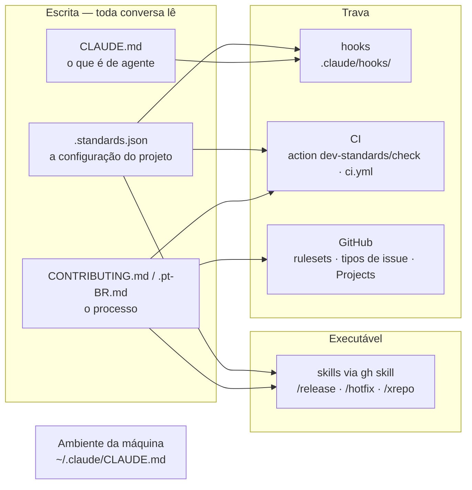

| Assunto | Fonte | Garantia |
|---|---|---|
| Processo: branch, commit, PR, merge, release, hotfix, issues, dependências | [CONTRIBUTING.pt-BR.md](../CONTRIBUTING.pt-BR.md) | Doc + Auto |
| Início de sessão, paradas, worktrees, assinatura | [CLAUDE.md](../CLAUDE.md) | Doc + Confirma |
| Escopos, `verify`, versão, gates, produção, repos irmãos | [.standards.json](../.standards.json) | Auto |
| Release, hotfix e pedidos entre repos | skills em `.claude/skills/`, instaladas com `gh skill` na versão do padrão | Skill |
| Checagens de todo PR | action `diego-castilho/dev-standards/check@vX.Y.Z` | Auto |
| Tipos de issue e campo Priority | `.standards/issue-types.json` e `.sh`, na conta | Auto |
| Proteção de `main` e `develop` | `.standards/rulesets.sh` | Bloqueado |
| Por que é nativo ou script | [ADR-0001](adr/0001-recursos-nativos-do-github-primeiro.md) | Doc |
| Ambiente de uma máquina (caminhos, 1Password, node em container) | `~/.claude/CLAUDE.md` da máquina | Doc |

**Memória local de agente não é lugar de regra**: ela só existe numa máquina. Regra nova ou
corrigida entra no documento, no mesmo PR que a motivou.

## 2. O ciclo de uma mudança

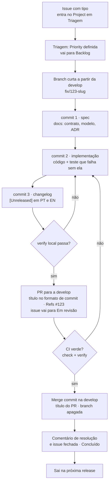

## 3. Gitflow

`main` é o que está publicado; `develop` é a linha de trabalho. A `main` **só** muda pelo
squash de um PR de release ou de hotfix, e volta para a `develop` logo depois.

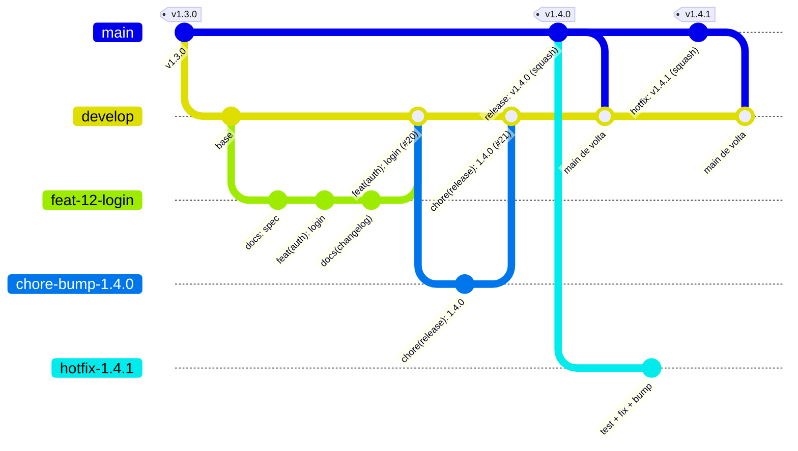

> No diagrama os nomes de branch usam `-` no lugar de `/` (limitação do Mermaid). No
> repositório são `feat/12-login`, `chore/bump-1.4.0` e `hotfix/1.4.1`.

| Regra | Garantia |
|---|---|
| Nunca push direto na `main`; ela só muda por PR | Bloqueado (GitHub e hook) |
| Nunca force-push nem apagar a `main` ou a `develop` | Bloqueado (GitHub e hook) |
| Merge de PR com base `main` só se for `release: vX.Y.Z` ou `hotfix: vX.Y.Z` | Bloqueado (os outros, hook) · Confirma (esses) |
| `develop` "N commits à frente" da `main` é esperado: só a `main` é compactada | Doc |

## 4. Branches

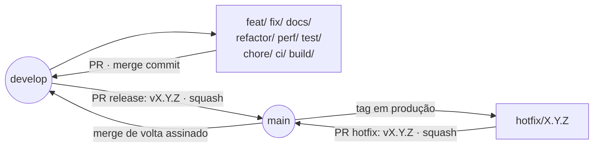

| Formato | Exemplo | Base → destino |
|---|---|---|
| `<prefixo>/<issue>-<slug>` | `fix/236-dedup-entries` | `develop` → `develop` |
| `<prefixo>/<slug>` (sem issue) | `feat/oauth-login` | `develop` → `develop` |
| `chore/bump-X.Y.Z` | `chore/bump-1.4.0` | `develop` → `develop` |
| `hotfix/X.Y.Z` | `hotfix/1.4.1` | tag em produção → `main` |
| `claude/…` (criada pelo Claude Code na nuvem) | `claude/fix-login-a1b2` | `develop` → `develop` |
| `dependabot/…` (atualização de dependência) | `dependabot/github_actions/…` | `develop` → `develop` |

Letras minúsculas, sem acento. O CI recusa o que estiver fora disto (**Auto**). A branch é
apagada no merge (**Auto**, GitHub).

## 5. Commits

**Anatomia:**

```
fix(import): keep the original currency when the export omits it
│   │        │
│   │        └─ assunto: inglês, imperativo, sem ponto final; alvo 72, máximo 100
│   └─ escopo: obrigatório em feat, fix, perf e refactor; da lista commitScopes
└─ tipo: feat fix perf refactor style docs test build ci chore revert

<corpo: o sintoma, a causa e só então o que mudou>

BREAKING CHANGE: <quando quebra compatibilidade; o assunto leva "!">
```

**Ordem dentro de uma branch:**

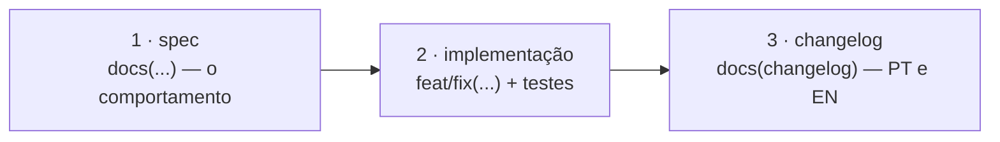

| Tipo | Escopo | Seção do CHANGELOG |
|---|---|---|
| `feat` | obrigatório | Adicionado / Added |
| `fix` | obrigatório | Corrigido / Fixed |
| `perf` | obrigatório | Alterado / Changed |
| `refactor` | obrigatório | — |
| `style`, `docs`, `test`, `build`, `ci`, `chore` | opcional | — (ou Documentação / Alterado) |
| `revert` | — | a seção do que foi revertido |

| Regra | Garantia |
|---|---|
| Formato, tipo, escopo, tamanho, ponto final | Auto (action `check`) |
| Corpo explica o problema | Doc |
| Commits, merges e tags assinados pela chave do mantenedor (SSH) | Bloqueado na `main` e na `develop` (GitHub) |
| Assinatura falhou: nunca contornar pela API, pela web ou com outra chave | Doc (CLAUDE.md) |
| Só automação em workflow (bot) commita pela API, para sair assinada pelo GitHub | Doc |

## 6. Pull requests e merge

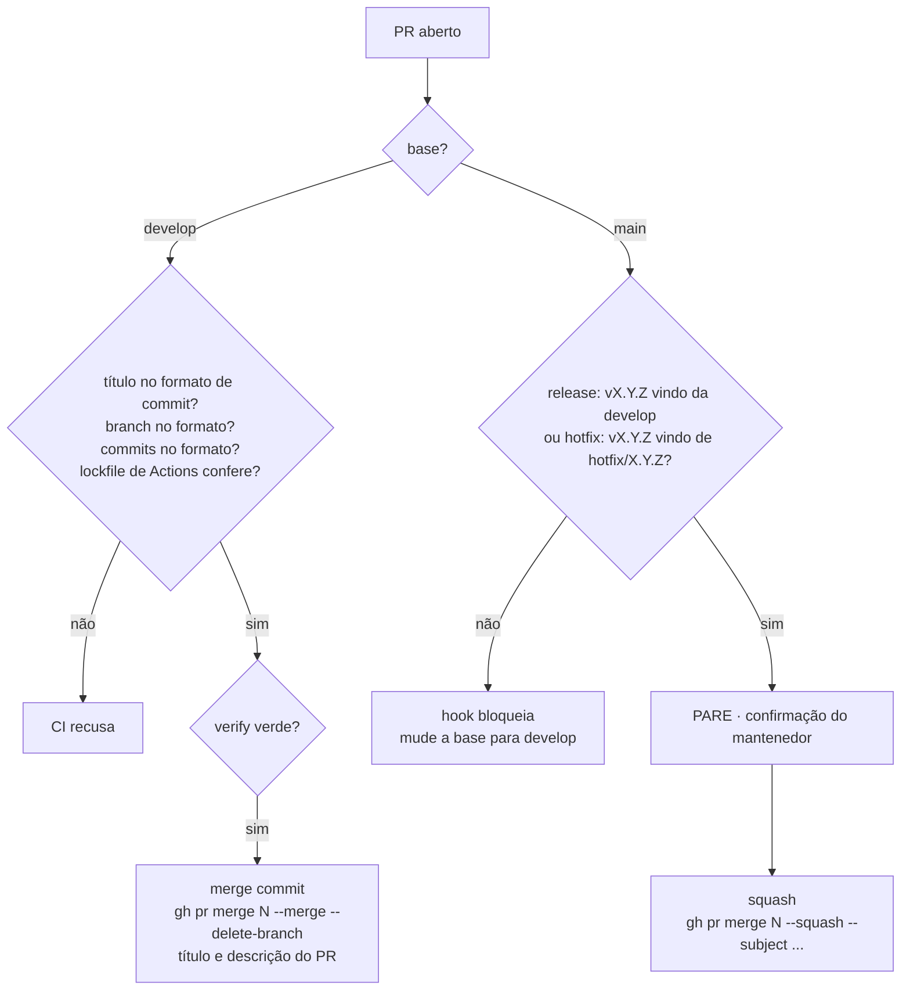

| Destino | Método | Comando |
|---|---|---|
| branch curta → `develop` | merge commit | `gh pr merge N --merge --delete-branch` |
| release `develop` → `main` | squash | `gh pr merge N --squash --subject "release: vX.Y.Z" --body "<uma linha>"` |
| hotfix → `main` | squash | `gh pr merge N --squash --subject "hotfix: vX.Y.Z" --body "<uma linha>"` |

Na `develop` não há `--subject`: o repositório é configurado (`rulesets.sh`) para o merge
commit levar o título e a descrição do PR. Rebase merge fica desligado (**Auto**).

**Checklist de todo PR para a `develop`:** teste cobrindo a mudança (numa correção, um teste
que falha sem ela), documentação no mesmo PR, CHANGELOG em `[Unreleased]` em PT e EN, nada de
dado sensível, ADR para decisão difícil de reverter.

Use `Refs #N`, não `Fixes #N`: fechar uma issue pede o comentário de resolução.

**PRs empilhados:** com `gh stack` (`init`, `add`, `submit`), merge de baixo para cima com
`gh stack merge --merge`. Nunca trocar base nem apagar branch da pilha à mão.

## 7. Release

Roteiro executável: skill `/release`.

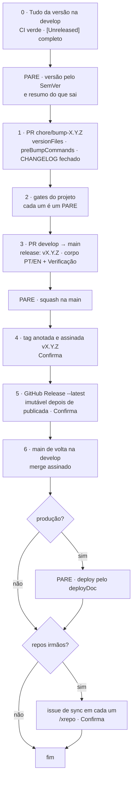

**SemVer:** correção → patch; funcionalidade retrocompatível → minor; quebra de contrato ou de
formato de dado → major (antes da 1.0.0, a quebra sobe o minor). A release publicada é
**imutável**: tag e arquivos não mudam depois (**Auto**, GitHub).

## 8. Hotfix

Para um defeito **em produção** que não pode esperar, quando a `develop` tem trabalho que
ainda não pode sair. Roteiro executável: skill `/hotfix`.

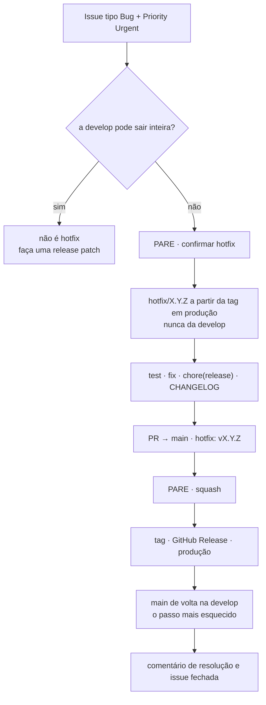

No CHANGELOG da `develop`, depois do merge de volta, a seção `[X.Y.Z]` do hotfix fica
**abaixo** do `[Unreleased]`, que continua com o que já estava lá.

## 9. Issues, tipos e Projects

**Toda pendência vira issue**, nunca item de `BACKLOG.md`, de um plano ou de uma lista de
TODO. Um documento pode agrupar pendências, mas cada item aberto aponta para a sua issue. Os
formulários já definem o tipo; repositório fora do padrão recebe os mesmos formulários do
repositório público `.github` da conta.

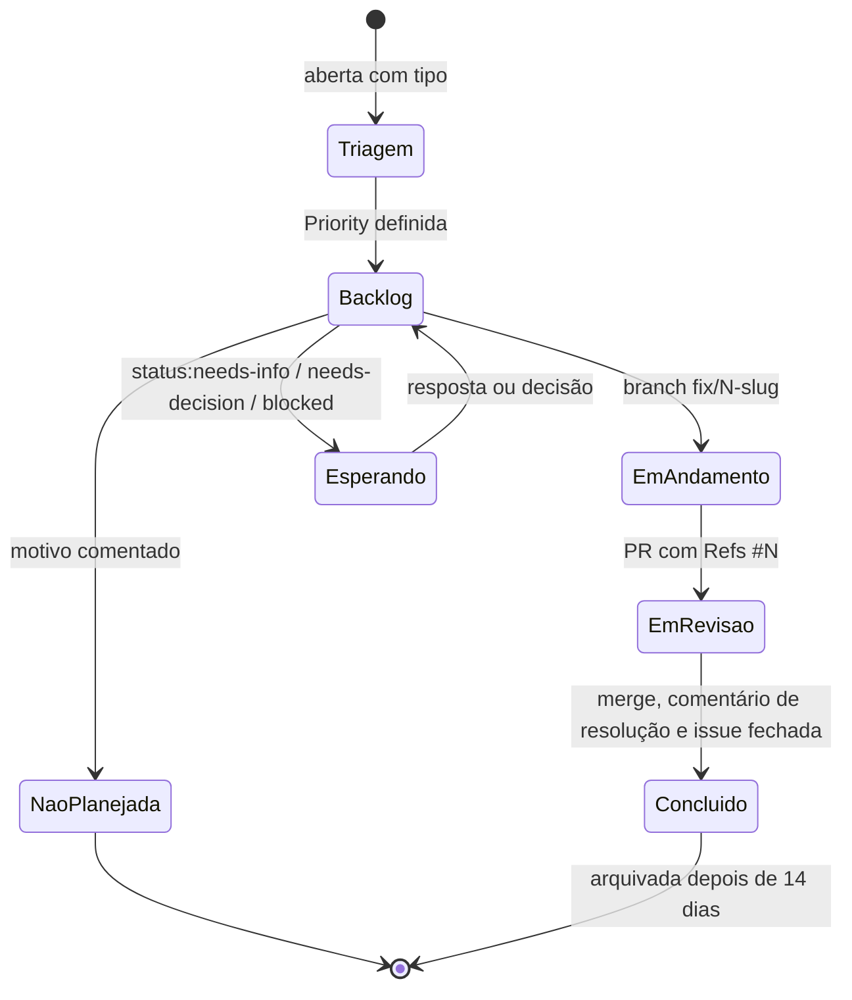

| O quê | Onde | Regra |
|---|---|---|
| Tipo | tipo de issue nativo: `Bug`, `Feature`, `Task`, `Docs`, `Question` | exatamente um |
| Prioridade | campo nativo Priority: `Urgent`, `High`, `Medium`, `Low` | exatamente um, na triagem |
| Contrato | label `contract` | quando mexe em contrato consumido por outro repo |
| Estado | `status:needs-info`, `status:needs-decision`, `status:blocked` | zero ou mais |
| Verificação | `needs-verification` | resolvida, esperando quem pediu |
| Entre repos | `xrepo`, `from:<repo>`, `parity` | só com `xrepo.enabled` |

`gh issue create --type <Tipo>` define o tipo; a prioridade vai por
`.standards/issue-types.sh priority`, porque o `gh` não tem opção para campo de issue. As
labels são criadas e migradas por `.standards/labels.sh`, que só apaga uma label antiga
depois que todas as suas issues já têm tipo ou Priority.

**Projects, um por produto** ([ADR-0001](adr/0001-recursos-nativos-do-github-primeiro.md)):
produto com dois repositórios (web e app) tem um Project só. As colunas são as do diagrama
acima, e o GitHub move os itens sozinho (**Auto**):

| Evento | Coluna |
|---|---|
| Issue ou PR aberto no repositório | Triagem |
| PR ligado à issue | Em revisão |
| Item fechado ou PR mergeado | Concluído |
| Item reaberto | Backlog |
| 14 dias em Concluído | arquivado |

Mudar Priority e mover para Backlog ou Em andamento é manual. Arrastar para Concluído **não**
fecha a issue: quem fecha deixa antes o comentário de resolução. As visões fixas são Quadro,
Triagem, Por prioridade, Pedidos entre repos e Aguardando verificação.

## 10. Pedidos entre repositórios

Os repositórios conversam **só por issue**. A issue mora no repo onde o trabalho acontece.
Roteiro executável: skill `/xrepo`.

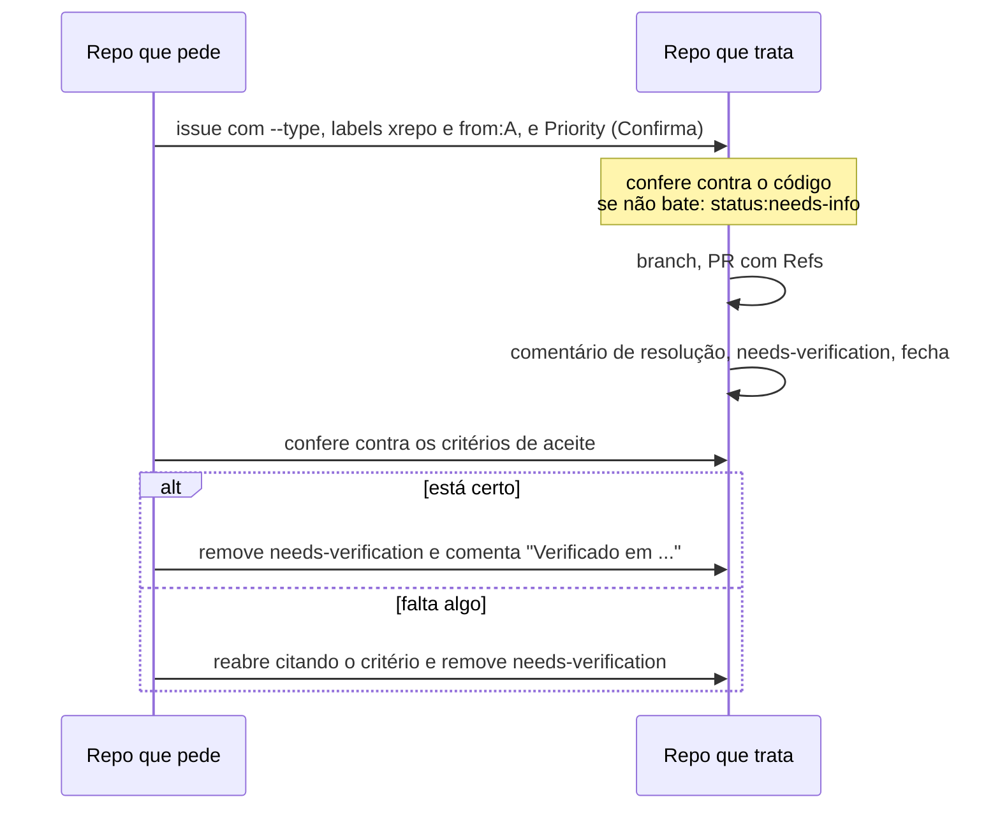

**Quem pediu é o único que remove `needs-verification`. Quem tratou é o único que fecha.**
Conhecimento permanente (contrato, decisões) vive em documento versionado; a issue aponta
para ele. Repos nunca escrevem arquivo um no outro. No Project, a visão **Pedidos entre
repos** reúne os `xrepo`, e **Aguardando verificação** mostra o que falta conferir.

## 11. Trabalho com agentes

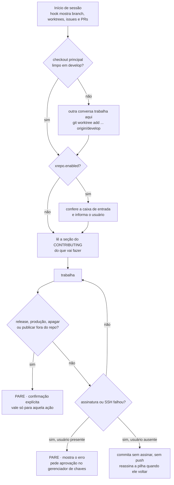

- **Autorização vale para aquela ação, naquele momento.** Não se generaliza.
- **Hook, classificador ou ruleset bloqueou:** não contorne; explique o que ia fazer e espere.
- **Assinatura nunca é contornada:** nada de commit pela API, pela web ou com outra chave.
  Com o usuário presente, `ssh -T git@github.com` dispara um novo pedido de aprovação.

## 12. Travas automáticas

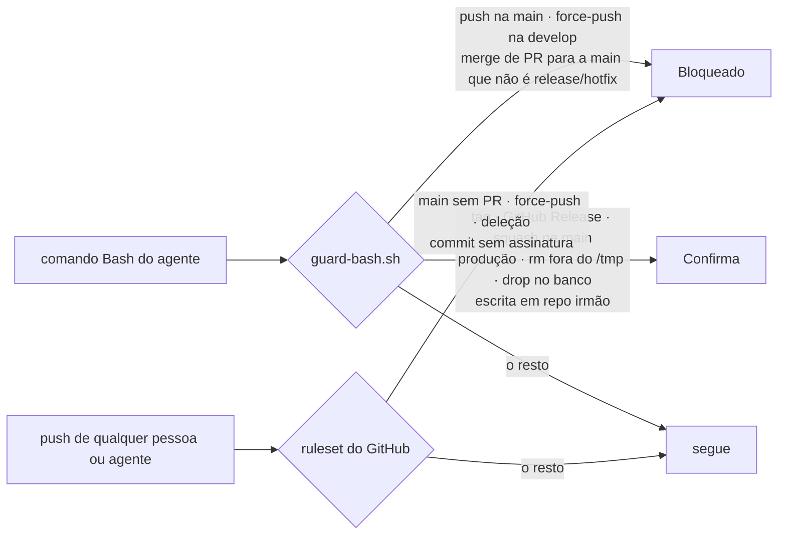

| Onde | O que garante |
|---|---|
| `.claude/hooks/guard-bash.sh` | as paradas acima, com caminhos e containers de produção do `.standards.json` |
| `.claude/hooks/session-start.sh` | o estado do checkout, issues e PRs no início de cada conversa |
| action `dev-standards/check` (CI) | branch, título, commits, paridade EN/PT, IP privado em Markdown, lockfile de Actions |
| `ci.yml` (CI) | o `verify` do projeto (ou aviso, com `verifyRunsIn: "local"`) |
| `rulesets.sh` (GitHub) | `main` só por PR; `main` e `develop` sem force-push, sem deleção e com commits assinados; títulos de merge e squash vindos do PR; rebase desligado |
| Releases imutáveis (GitHub) | tag e arquivos de uma release publicada não mudam |

O ruleset vale para qualquer pessoa ou agente, inclusive fora do Claude Code; o hook trava o
agente antes de o comando chegar ao GitHub e cobre o que o ruleset não alcança (produção,
banco, remoções, repos irmãos).

## 13. Dependências e Actions

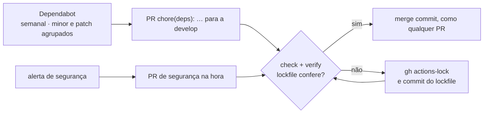

| Regra | Fonte | Garantia |
|---|---|---|
| Toda action, inclusive as transitivas, fixada num commit em `.github/workflows/actions.lock` (`gh actions-lock`) | CONTRIBUTING, "Dependências" | Auto (check e runner) |
| Atualização pelo Dependabot (`.github/dependabot.yml`, semeado uma vez, depois do projeto) | CONTRIBUTING, "Dependências" | Auto |
| As checagens chegam pela action `check` na tag da versão; o sync só troca a tag | CONTRIBUTING, "Dependências" | Auto |
| Actions restritas às do GitHub, verificadas e a lista liberada; action nova precisa ser liberada antes | configuração do repositório | Bloqueado (GitHub) |

## 14. Dados sensíveis e idiomas

**Nunca** em commit, doc, issue, PR ou log, mesmo com o repositório privado: token, senha,
chave, `.env`, URL com credencial; dado pessoal ou de cliente real (a lista `sensitive` do
`.standards.json`); IP real ou topologia interna (use `192.0.2.x` em documento); fixture não
higienizado. Em repositório público, a detecção de segredos com proteção de push recusa o
push (**Auto**, GitHub), e o e-mail dos commits é o noreply do GitHub.

| O quê | Idioma |
|---|---|
| Commits, branches, labels, código | inglês |
| `CHANGELOG.md`, PR de release e de hotfix, GitHub Release | PT e EN |
| `README`, `CONTRIBUTING`, `SECURITY` | EN no `.md`, PT no `.pt-BR.md`, mesmas seções (Auto) |
| `CLAUDE.md`, `docs/`, ADR, issues, este mapa | português |

<!-- standards:end -->

## Específico deste projeto

<!-- Regras que valem só aqui, em diagrama ou tabela: ambientes, deploy, contrato, domínio.
     O sync do padrão nunca altera este trecho. -->
